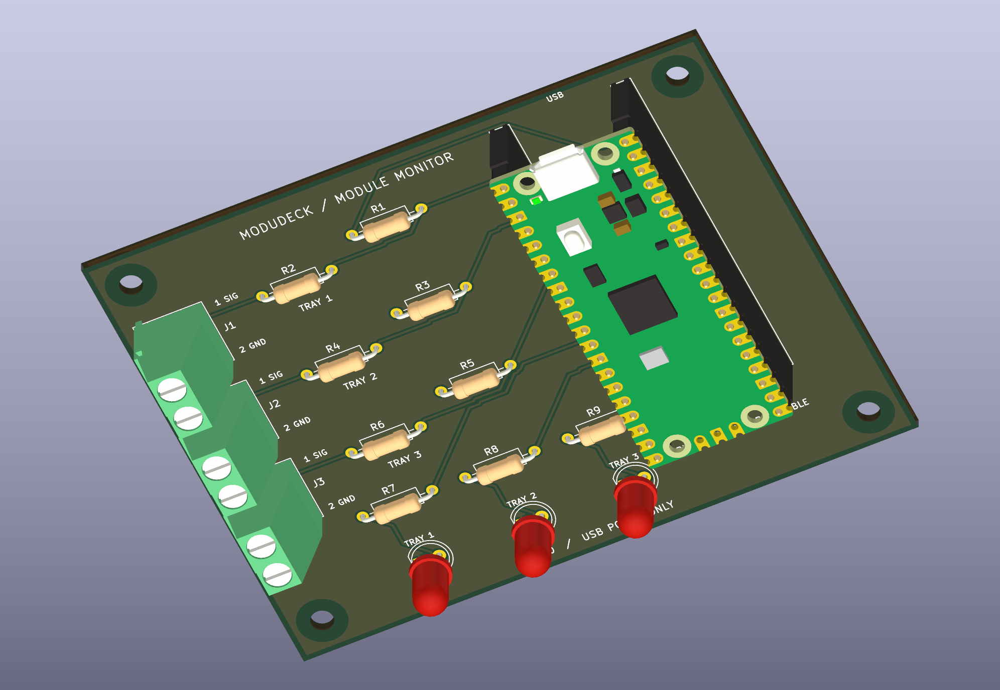

# ModuDeck Module Monitor — routed KiCad design

This folder is the **canonical editable electronics project**. Open [ModuDeck-Module-Monitor.kicad_pro](ModuDeck-Module-Monitor.kicad_pro) in **KiCad 10.0.7 or later**. The completed schematic and routed two-layer PCB are present here. Old KiCad files at the repository root are retained as historical work and must not be used for manufacturing this revision. The main repository's `JOURNAL.md` and `BOM.md` were not modified.

## Completed work and limits

The existing schematic was completed from its first input channel. The initially empty board now contains a 90 x 70mm two-layer layout, three dry-contact inputs, three red LED outputs, two removable Pico socket rows, four M3 holes, screw copper keepouts and ground pours on both faces. All carrier electrical parts are through-hole. The original RP2040 Pico remains a removable assembled module. USB and BOOTSEL are accessible from above.

**ERC: 0 errors, 0 warnings. DRC: 0 violations, 0 unconnected items, 0 schematic-parity issues.** Independent net/pad/geometry/export assertions passed. The existing firmware test and six additional host simulation tests passed. These are software checks. **No fabricated PCB, physical assembly, Pico hardware test, real USB serial test, switch actuation test or enclosure fit test has been performed.** See [CHECKS.md](CHECKS.md) and raw reports in [checks/](checks/).

The outline, mounting pattern and cable/headroom allowances are provisional because the bay has not been measured. See [MECHANICAL.md](MECHANICAL.md). Review physical fit and test a Pico before ordering production. No components or PCBs were ordered.

## Circuit

| Channel | Input GPIO / Pico pin | Pull-up | Series to J pin 1 | LED GPIO / Pico pin | LED resistor |
|---|---|---|---|---|---|
| Tray 1 | GP2 / 4 | R1 10k to 3V3 | R2 1k / J1 | GP10 / 14 | R7 1k / D1 |
| Tray 2 | GP3 / 5 | R3 10k to 3V3 | R4 1k / J2 | GP11 / 15 | R8 1k / D2 |
| Tray 3 | GP4 / 6 | R5 10k to 3V3 | R6 1k / J3 | GP12 / 16 | R9 1k / D3 |

Pico **pin 36 is 3V3 OUT**. All J pin 2 connections and LED cathodes share GND; the carrier connects Pico GND pins 3, 8, 13, 18, 23, 28 and 38. AGND 33 is unused on the carrier and referenced internally by Pico. VBUS 40, VSYS 39, ADC_VREF 35, 3V3_EN 37, RUN 30 and unused GPIOs have intentional no-connect markers. Their socket pads have no carrier traces.

The external normally-open microswitch closes J pin 1 to J pin 2 when seated. GPIO -> 1k -> LED anode; cathode -> GND. D1-D3 pad 1 = K, pad 2 = A. Closed input voltage is nominally **0.30V**, approximately **0.328V** with worst-case 5% resistor tolerances at nominal 3.3V. RP2040 specifies VIL <= 0.8V and VIH >= 2.0V at IOVDD=3.3V. Open input is pulled to 3.3V. LED current is estimated at **1.3mA** for Vf=2.0V; these are calculations, not measurements.

The sole supply/data path is the original Pico micro-USB. No external power input, PC power output, battery connection or charger is added. This PCB observes contacts and does not power trays. A broken switch cable reports absent; presence cannot distinguish removal from cable failure.

## Delivered files

- [Editable schematic](ModuDeck-Module-Monitor.kicad_sch) and [routed PCB](ModuDeck-Module-Monitor.kicad_pcb)
- [Schematic PDF](exports/schematic.pdf)
- [Gerber/Excellon ZIP](exports/ModuDeck-Module-Monitor-manufacturing.zip) and [uncompressed files/drill maps](exports/gerbers/)
- [PCB symbol BOM](exports/pcb-bom.csv) and [expanded purchasing BOM](exports/purchasing-bom.csv), including sockets, headers, external parts, minimum quantities, links and price status
- [Component and price notes](COMPONENTS.md), [mechanical assumptions](MECHANICAL.md), [checks](CHECKS.md)
- [English completed-work description](COMPLETED-WORK.txt)

`fp-lib-table` registers project-local footprints. STEP models in `models/` use `${KIPRJMOD}` paths. Used symbol definitions are cached in the schematic; standard KiCad symbol libraries support library comparisons. The A1 assembly footprint contains both female 1x20 sockets, with original Pico numbering. [THIRD-PARTY.md](THIRD-PARTY.md) records library attribution.

The manufacturing ZIP contains seven Gerbers (F/B copper, F/B mask, F/B silkscreen, Edge.Cuts), a Gerber job file and separate PTH/NPTH drills. It has **70 plated component holes, four 3.2mm non-plated mounting holes and no vias**. No stencil files are needed. File completeness and drill counts were checked; no fabricator CAM acceptance or quote was obtained.

## Firmware and USB serial

Install official MicroPython for **RPI_PICO / original RP2040 Pico**, then copy [firmware/main.py](firmware/main.py) and [firmware/logic.py](firmware/logic.py) to the Pico filesystem root. Existing firmware was retained and updated to disable internal pull-ups explicitly because this board supplies external 10k pull-ups. Inputs are active low with independent 30ms debounce and 5ms polling. GP10/11/12 light for confirmed presence. Startup starts absent until the debounce confirms a closed contact.

RP2 MicroPython stdout uses USB CDC serial, shared with REPL. One newline-terminated JSON message is printed on startup, each confirmed change and once per second while unchanged: `{"type":"modudeck_presence","trays":[true,false,true]}`. Tray order is 1,2,3. Host readers should accept matching JSON and ignore REPL/startup banners. A heartbeat alone does not implement host disconnection handling. Ctrl-C exits the loop and turns off LEDs in `finally`. No UART is configured.

Run `python test_logic.py` and `python test_firmware.py`. Simulations use fake GPIO/time objects to validate the actual main loop; they do not run on RP2040 or transmit through physical USB. Firmware deployment has not been performed on a Pico.

## Six actual design images

These are exported KiCad drawings/renders, **not hardware photos or AI-generated illustrations**. Bottom copper is mirrored for a solder-side view. Old conceptual images in `docs/01-architecture.png` through `docs/04-pcb-placement.png` remain historical planning illustrations.

| Image | Source |
|---|---|
| [Full schematic](exports/images/01-schematic-complete.png) | Completed KiCad schematic PDF |
| [Input detail](exports/images/02-input-detail.png) | PDF crop of all three inputs |
| [LED detail](exports/images/03-led-detail.png) | PDF crop of all three LED paths |
| [PCB top](exports/images/04-pcb-top.png) | F.Cu + F.SilkS + Edge.Cuts |
| [PCB bottom](exports/images/05-pcb-bottom.png) | Mirrored B.Cu + B.SilkS + Edge.Cuts |
| [3D view](exports/images/06-board-3d.png) | KiCad renderer with local STEP models, also `exports/cover.png` |

## Sources

- [Official original Pico pinout](https://datasheets.raspberrypi.com/pico/Pico-R3-A4-Pinout.pdf)
- [Official Pico datasheet](https://datasheets.raspberrypi.com/pico/pico-datasheet.pdf), mechanical/pin allocation and powerchain sections
- [Official RP2040 datasheet](https://datasheets.raspberrypi.com/rp2040/rp2040-datasheet.pdf), section 5.5.3.4, Table 625
- [MicroPython RP2 quick reference](https://docs.micropython.org/en/latest/rp2/quickref.html) and [Pin API](https://docs.micropython.org/en/latest/library/machine.Pin.html)
- Exact parts, drawings and seller links in [COMPONENTS.md](COMPONENTS.md) and the purchasing BOM
